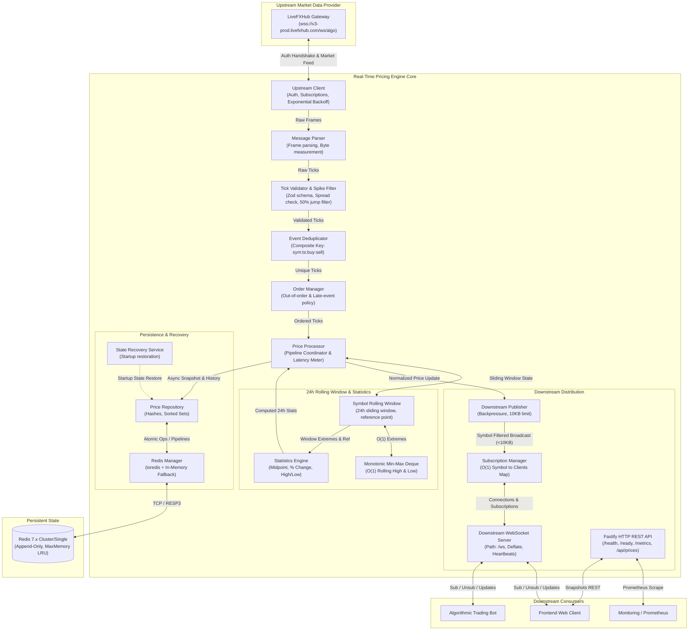

# Real-Time Pricing Engine: Architecture & Data Flow

This document details the system architecture, internal processing pipeline, and data flow of the Real-Time Pricing Engine.

## 1. System Overview

The Real-Time Pricing Engine is an ultra-low-latency, fault-tolerant market data ingestion and distribution platform. It connects to an upstream WebSocket feed, authenticates, validates, deduplicates, orders events, maintains a continuous rolling 24-hour window per symbol, independently computes 24-hour highs, lows, and percentage changes, persists state to Redis, and broadcasts optimized real-time price updates to downstream WebSocket clients.

## 2. End-to-End Architecture Diagram

## 3. Data Processing Pipeline Breakdown

1. **Ingestion & Protocol Handling**:
   - `UpstreamClient` initiates the TLS WebSocket connection with the upstream endpoint.
   - It performs an explicit handshake: `{ action: "auth", api_key: "...", secret: "..." }`.
   - Only upon genuine authentication acknowledgement does it transmit the subscription for all 61 symbols.
   - Exponential backoff with random jitter handles network disconnects and server restarts.

2. **Validation & Spike Filtering**:
   - Every frame passes through `MessageParser` and `TickValidator`.
   - Validates that symbols belong to the official 61-symbol catalog.
   - Rejects non-positive prices and crossed bid-ask spreads (`sell < buy`).
   - Rejects price spikes deviating by more than 50% in a single tick from the prior observation without verification.

3. **Deduplication & Out-of-Order Handling**:
   - `EventDeduplicator` computes a composite hash `${symbol}:${sourceTimestamp}:${buy}:${sell}` within an in-memory sliding ring buffer (capacity: 50,000 entries).
   - `OrderManager` checks timestamps:
     - In-order ticks immediately update the spot snapshot and advance the window.
     - Late-arriving ticks within the 60-second tolerance window are safely incorporated into the historical 24-hour observation array to preserve accurate statistical computation without rewinding the live spot price.

4. **Rolling 24-Hour Statistics Engine**:
   - Per assignment rules, incoming `low_24h`, `high_24h`, and `change_24h` fields are strictly ignored and computed independently.
   - Employs a **Monotonic Min-Max Deque**:
     - Amortized $O(1)$ updates and $O(1)$ queries for rolling 24-hour maximum and minimum prices.
   - Reference price policy:
     - The engine tracks the price closest to $T - 24\text{ hours}$.
     - When observations expire past 24 hours, the most recently expired observation is retained as the baseline reference point for percentage change.
     - If history is younger than 24 hours, the first observed tick serves as the baseline, starting percentage change smoothly at 0.00%.

5. **Persistence & Resilience**:
   - `PriceRepository` uses Redis Hashes for latest snapshots and Redis Sorted Sets (scored by timestamp) for historical observations.
   - State recovery runs automatically on startup, restoring 24-hour highs, lows, and reference prices so that process restarts do not reset metrics.
   - In-memory fallback enables zero-dependency testing and survival during temporary Redis outages.

6. **Downstream WebSocket Server**:
   - Supports multi-tenant symbol-based subscriptions.
   - Immediately pushes an initial snapshot upon subscription.
   - Employs client buffer backpressure controls to drop ticks for slow consumers and prevent memory leaks.
   - Outbound payload size is kept strictly under 10 KB (actual payload: ~232 bytes uncompressed, ~168 bytes compressed).
